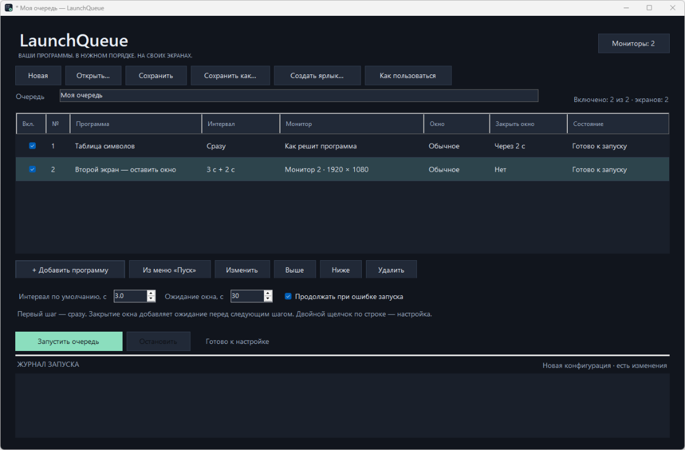
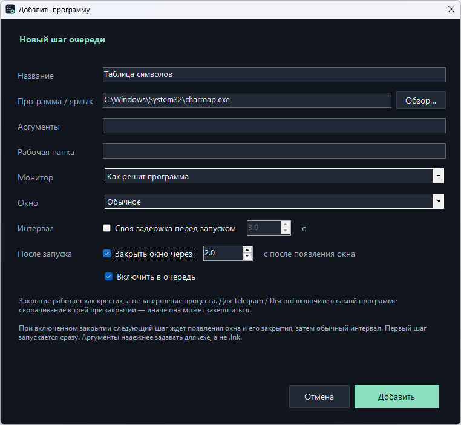

# LaunchQueue

[Русский](README.md) | **English**

LaunchQueue is a Windows desktop app for starting programs in a defined order, placing their windows on selected monitors, and saving workflows as JSON profiles. Version 1.1.0 adds normal window closing after launch with a separate delay.

The application UI is currently **Russian only**. This English README does not imply an English interface.

## Features

- A queue with shared and per-item intervals; reorder or disable items and configure arguments and working directories.
- Add files through a picker, drag and drop, or search Start menu and desktop shortcuts.
- Select monitors and window modes; close detected windows after a delay without forcibly terminating their processes.
- JSON profiles, launch shortcuts, execution logs, warnings, and cancellation of subsequent actions.
- C# / WinForms / .NET 9, with no third-party NuGet packages.

## Screenshots





## Quick start

1. Use Windows x64 with **.NET Desktop Runtime 9 x64**. Desktop Runtime includes WinForms support; the standard .NET Runtime alone is insufficient. Get it from the [official .NET 9 download page](https://dotnet.microsoft.com/download/dotnet/9.0).
2. Open [dist/LaunchQueue-win-x64.zip](dist/LaunchQueue-win-x64.zip) on GitHub and use the download button to save the actual file, not the web page.
3. Extract the **entire archive** into a permanent, writable folder. Do not run the EXE inside the ZIP or copy only the EXE.
4. Run `app/LaunchQueue.exe`.
5. Add programs and choose their order, intervals, and monitors.
6. Save a profile in `profiles/`, then click **«Запустить очередь»** (Run queue) or press `F5`.

The ZIP is a framework-dependent Windows x64 build: .NET must be installed separately. It contains `app/` with the application build files, an empty `profiles/` folder, examples, icons, and READMEs. Source code, tests, and private logs are not included in the distribution.

## Configure a queue

1. **«Новая»** (New) creates a profile; **«Открыть…»** (Open) loads JSON. Give the queue a descriptive name.
2. **«+ Добавить программу» → «Обзор…»** (Add program → Browse): select an `.exe`, `.lnk`, `.bat`, `.cmd`, or `.appref-ms` file. You can also drop these files onto the main window.
3. **«Из меню „Пуск“»** (From Start menu) searches `.lnk` and `.appref-ms` files in user and shared Start menu and desktop folders. Search by name; use `Ctrl` / `Shift` to select multiple entries. This is a shortcut list, not a complete inventory of installed software.
4. Double-click a row or click **«Изменить»** (Edit) to open its settings. Arguments are more reliable with `.exe` files; `.lnk` files may already contain arguments. Quote paths containing spaces inside arguments according to the target program's rules.
5. **«Выше» / «Ниже»** (Up / Down) change the order. Clear **«Вкл.»** (Enabled) to skip an item and its delay. **«Удалить»** (Delete) removes the queue entry, not the installed program.
6. Set the default interval, window-search timeout, and **«Продолжать при ошибке запуска»** (Continue on launch error). An individual delay belongs to the item **before which** the wait occurs.
7. **«Сохранить» / «Сохранить как…»** (Save / Save as) save the profile. New or modified queues must be saved before running, and at least one item must be enabled.
8. Editing is disabled while the queue runs. Follow row statuses and the log; **«Остановить»** (Stop) cancels subsequent launches, moves, and close requests.

Keyboard shortcuts: `Ctrl+S` saves, `Ctrl+O` opens, and `F5` runs. Concurrent execution of the same profile path is blocked within the current Windows session; a JSON copy at another path is a separate queue.

### Monitors and window modes

- **«Как решит программа»** (Let the program decide) does not select a monitor. **«Мониторы»** (Monitors) lists connected screens; numbers come from Windows `DISPLAY` device names.
- A detected window is centered in the selected monitor's working area; oversized dimensions are constrained to that area.
- **«Обычное»**, **«На весь экран (развернуть)»**, and **«Свёрнутое»** map to `Normal`, `Maximized`, and `Minimized`. Maximizing is not a game's exclusive fullscreen mode.
- If the selected monitor is disconnected, the primary monitor is used and a warning is logged. Recheck selections after changing the display configuration.
- The target application creates its window first, so it may briefly appear on another screen. LaunchQueue looks for a suitable window, not for full application readiness.

### Timing rules

**The first enabled item starts immediately**, even if it has an individual delay.

With `CloseWindowAfterLaunch: false`, the interval is the minimum time between launch commands for consecutive enabled items. Window detection and placement run asynchronously without delaying the next launch; completion of the entire queue still waits for those tasks.

With `CloseWindowAfterLaunch: true`, the next item waits for this sequence:

1. Detect a stable matching window and attempt its placement / window-mode adjustment.
2. Wait `CloseDelaySeconds` after that stage.
3. Send standard `WM_CLOSE`, like clicking the window's close button; allow up to **2 seconds** to confirm that the window is closed or hidden.
4. Only then start the **full regular interval of the next enabled item**: its `DelaySeconds`, or the shared `DefaultDelaySeconds`.

Example: the default interval is 3 s; A closes its window after 2 s; B has no interval override and window closing is disabled; C has a 4 s interval override.

| Event | Time from queue start |
| --- | --- |
| Launch command for A | 0 s |
| A's window is found and adjusted (example assumption) | 1 s |
| Close request sent to A | 3 s |
| Hiding confirmed after 0.5 s (example assumption) | 3.5 s |
| B starts after its regular 3 s interval | 6.5 s |
| C starts after its individual 4 s interval | 10.5 s |

This illustration excludes OS overhead and is not an exact timing guarantee. If confirmation takes the full 2 s, B starts at roughly 8 s. The formula is **window readiness and placement + close delay + up to 2 s confirmation + next item's interval**. Closing also runs for the last item, even when there is no subsequent launch.

If no window is found within `WindowWaitSeconds`, placement and closing are skipped with a warning; the next item's regular interval then begins. Failed placement does not prevent an attempt to close the detected window. Window warnings are not launch errors and do not stop the queue through `ContinueOnError`.

### Closing windows and staying in the tray

**LaunchQueue does not forcibly terminate processes or guarantee background operation.** Telegram and Discord stay in the tray only when their own close-to-tray settings are enabled; otherwise, they may exit. LaunchQueue does not change those settings. See [examples/messengers.json](examples/messengers.json), and check the paths and behavior of your installations first.

An application may show a save dialog or ignore closing. If the window remains visible after 2 s, LaunchQueue records a warning without terminating the process or answering the dialog. Stopping the queue does not itself close already launched programs; **a `WM_CLOSE` request already sent cannot be undone**.

## Shortcuts and command line

**«Создать ярлык…»** (Create shortcut) saves the profile first, then creates a `.lnk` with absolute paths to the current EXE and JSON. Moving the application folder, renaming the profile, or moving it breaks that shortcut: recreate it afterward.

Example from the extracted folder's root, in PowerShell:

```powershell
.\app\LaunchQueue.exe --profile ".\profiles\Morning.json" --run --close-after
```

| Option | Behavior |
| --- | --- |
| `--profile <path>` | Open a specific JSON profile; quote paths containing spaces. |
| `--run` | Run after the window opens; requires an explicit `--profile`. |
| `--close-after` | Close **LaunchQueue** only after a run with no errors, warnings, or cancellation. Does not start a queue by itself. |

Without `--run`, you can review the profile before running it manually. Without `--profile`, the UI attempts to reopen the last remembered profile. Unknown options are rejected. This is a GUI application, not a background service or a console runner. `--close-after` is separate from closing individual programs' windows.

## Profile format

The format remains **`Version: 1`**. Older profiles without the new fields load with `CloseWindowAfterLaunch: false` and `CloseDelaySeconds: 2`. This example shows the structure; replace the illustrative path with an existing file:

```json
{
  "Version": 1,
  "Name": "Work queue",
  "DefaultDelaySeconds": 3,
  "WindowWaitSeconds": 30,
  "ContinueOnError": true,
  "Items": [
    {
      "Name": "Editor",
      "FilePath": "%LOCALAPPDATA%\\Programs\\ExampleEditor\\Editor.exe",
      "Arguments": "",
      "WorkingDirectory": "",
      "Enabled": true,
      "DelaySeconds": null,
      "Monitor": "",
      "WindowMode": "Normal",
      "CloseWindowAfterLaunch": false,
      "CloseDelaySeconds": 2
    }
  ]
}
```

| Field | Value / constraints |
| --- | --- |
| `Version`, `Name` | Version must be `1`; the profile name must not be blank. |
| `DefaultDelaySeconds` | Shared interval, decimal 0–3600 s; default `3`. |
| `WindowWaitSeconds` | Window-search limit, integer 1–300 s; default `30`. |
| `ContinueOnError` | Continue after a launch error; default `true`. |
| `Items` | Array of items in execution order. |
| `Items[].Name`, `FilePath` | Item label and a nonempty path to the file to launch. |
| `Arguments` | Argument string; empty by default, passed without path conversion. |
| `WorkingDirectory` | Working folder; an empty string uses the launched file's folder. |
| `Enabled` | Whether to include the item; default `true`. |
| `DelaySeconds` | `null` uses the shared interval; otherwise decimal 0–3600 s. Ignored for the first enabled item. |
| `Monitor` | `""` lets the application decide; for example, `"\\\\.\\DISPLAY2"` in JSON selects a screen. |
| `WindowMode` | `Normal` (default), `Maximized`, or `Minimized`. |
| `CloseWindowAfterLaunch` | Whether to close the detected window; Boolean, default `false`. |
| `CloseDelaySeconds` | Decimal 0–3600 s; default `2`. Validated even when window closing is disabled. |

JSON decimals use a period. `FilePath` and `WorkingDirectory` expand variables such as `%APPDATA%`; relative paths are resolved against the JSON file's folder when loading. Saving after loading may turn them into absolute paths. In the item dialog, relative program paths use the LaunchQueue EXE folder, while relative working directories use the selected file's folder. Portable profiles do not make installed programs portable.

## Storage, security, and privacy

- In the standard layout, `profiles/` holds your queues, `logs/queue-*.log` holds execution logs, and `last-profile.txt` stores the path of the last profile opened or saved through the UI. The last profile does not run automatically without `--run`.
- The data root is the EXE folder's parent when that parent contains `profiles/`; otherwise, it is the EXE folder itself. Profiles can also be saved elsewhere. Local files require write access to the relevant folders.
- **Use trusted profiles only.** Profiles contain arbitrary launch commands, arguments, and scripts that run with your permissions; there is no sandbox. Review all paths and arguments before running someone else's JSON.
- LaunchQueue itself makes no network requests and sends no telemetry. Programs and scripts it launches may access the network and process data under their own policies.
- Profiles, logs, `last-profile.txt`, and test reports can expose local paths and other details. Review and sanitize them before publishing; do not put secrets in arguments.

## Build from source

Use Windows and **.NET SDK 9**. Run commands from the source repository root in PowerShell. Run `Build.cmd`, or its equivalent:

```powershell
dotnet build .\src\LaunchQueue.csproj -c Release -o .\app
.\app\LaunchQueue.exe
```

The project targets `net9.0-windows` and uses WinForms and Windows system APIs. A `Build.cmd` build also needs an installed runtime when moved to another PC.

### Tests

Tests launch their own windowed processes and require an interactive Windows desktop. After building, run the test EXE itself, not `dotnet test` or the DLL:

```powershell
dotnet build .\tests\LaunchQueue.Tests.csproj -c Release
$test = Start-Process .\tests\bin\Release\net9.0-windows\LaunchQueue.Tests.exe -ArgumentList '--test .\tests\artifacts\report.json' -Wait -PassThru
$test.ExitCode
```

The report is `tests/artifacts/report.json`, with supporting artifacts in `tests/artifacts/report.artifacts/`. Exit code `0` indicates successful completion; checks for unavailable monitors may be skipped, so inspect the report. Checks cover profiles, timing, disabled items, cancellation, placement, and window closing. They do not guarantee compatibility with every third-party application.

## Source layout

```text
src/
  Program.cs             — command-line options and entry point
  MainForm.cs            — queue, profiles, logs, and shortcuts
  ItemDialog.cs          — item settings and shortcut picker
  Configuration.cs       — model, JSON, validation, and monitors
  QueueRunner.cs         — timing, window detection, closing, and cancellation
  WindowsIntegration.cs  — COM shortcuts and Win32 window operations
  Theme.cs               — WinForms styling
examples/messengers.json  — messenger window-closing example
tests/                   — test runner and window probes
Build.cmd                — builds into app/
```

## Troubleshooting and limitations

| Problem | What to check |
| --- | --- |
| EXE will not start / asks for .NET | Install Desktop Runtime 9 x64 and extract the entire archive. |
| File or working directory not found | Correct the item's path; the example JSON does not install apps. Check `.lnk` targets after application updates. |
| Window not found | Increase the timeout up to 300 s; try a direct `.exe`. Store apps, `.appref-ms`, wrappers, and game launchers may not match a window. |
| Window cannot be moved / closed | Check fullscreen mode and privilege levels. Elevated target apps may block control; running LaunchQueue as administrator also elevates the commands it launches. |
| An existing window was affected | Classic single-instance apps may reuse an existing window; that window may also be moved or closed. |
| Messenger exits instead of staying in the tray | Enable close-to-tray in the messenger itself or disable window closing in the profile. |
| The next item starts later than expected | Include window detection, close delay, up to 2 s confirmation, and the next item's full interval. |
| LaunchQueue stays open after a shortcut run | Check the log: errors, warnings, or cancellation prevent `--close-after`. |

Window matching is heuristic: splash screens, multiple windows, wrapper processes, and exclusive fullscreen limit reliability. A successful launch command does not confirm full application readiness; a hidden window does not prove its process remains running.

## Contributing and licensing

Report issues with your Windows / .NET versions, reproduction steps, and a sanitized log. Keep pull requests focused, run relevant checks, and update both READMEs when behavior changes.

No `LICENSE` file is currently provided. Public source availability does not imply a particular open-source license or redistribution permission.
