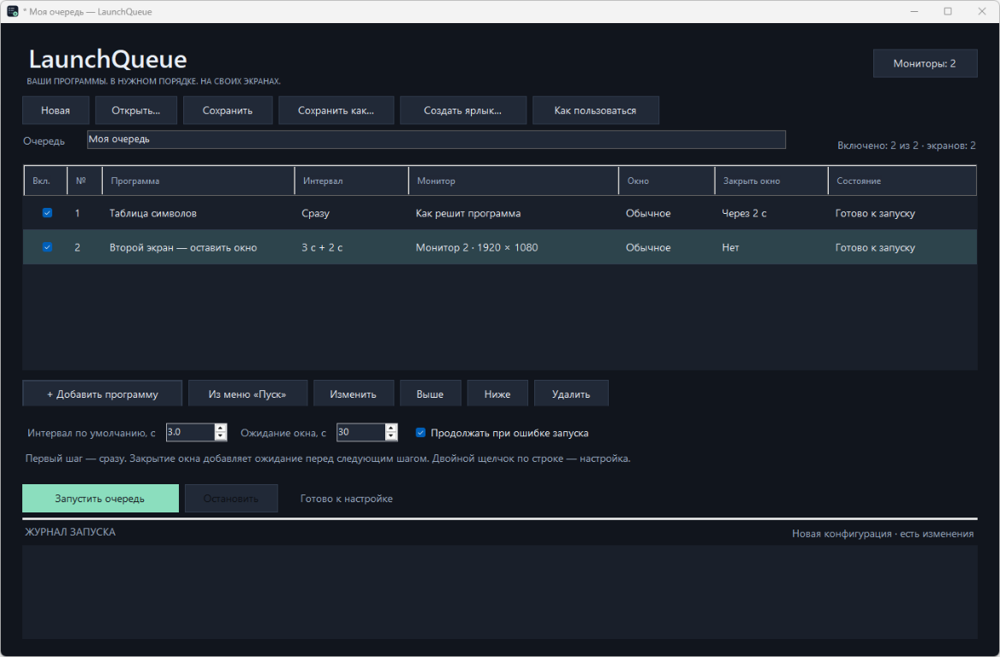
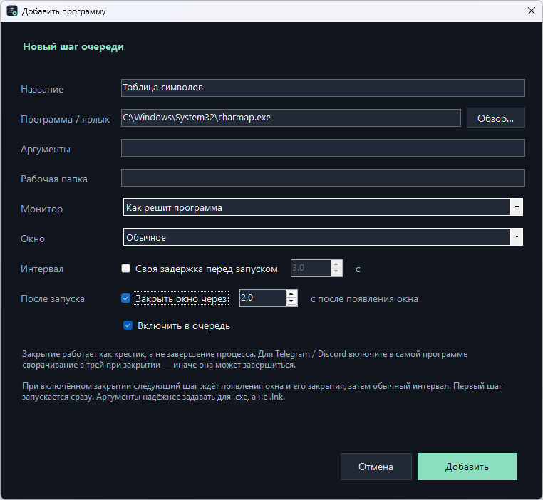

# LaunchQueue

**Русский** | [English](README.en.md)

LaunchQueue — настольная программа для Windows: запускайте приложения в заданном порядке, распределяйте их окна по мониторам и сохраняйте сценарии в JSON-профили. Версия 1.1.0 добавляет обычное закрытие окна после запуска с отдельной задержкой.

Интерфейс приложения сейчас на русском языке. Английская версия доступна для этой документации, не для интерфейса.

## Возможности

- Очередь с общим интервалом и индивидуальными задержками; изменение порядка, отключение шагов, аргументы и рабочие папки.
- Добавление через выбор файла, перетаскивание или поиск ярлыков из меню «Пуск» и рабочего стола.
- Выбор монитора и режима окна; закрытие найденного окна через заданное время без принудительного завершения процесса.
- JSON-профили, ярлыки запуска, журнал выполнения, предупреждения и отмена дальнейших действий.
- C# / WinForms / .NET 9, без сторонних NuGet-пакетов.

## Скриншоты





## Быстрый старт

1. Нужна Windows x64 с **.NET Desktop Runtime 9 x64**. Именно Desktop Runtime содержит поддержку WinForms; обычного .NET Runtime недостаточно. Загрузка: [официальная страница .NET 9](https://dotnet.microsoft.com/download/dotnet/9.0).
2. Откройте [dist/LaunchQueue-win-x64.zip](dist/LaunchQueue-win-x64.zip) на GitHub и скачайте сам файл кнопкой загрузки, а не сохраняйте веб-страницу.
3. Распакуйте **весь архив** в постоянную папку с правом записи. Не запускайте EXE внутри ZIP и не переносите только EXE.
4. Запустите `app/LaunchQueue.exe`.
5. Добавьте программы, выберите порядок, интервалы и мониторы.
6. Сохраните профиль в `profiles/` и нажмите **«Запустить очередь»** или `F5`.

ZIP — framework-dependent сборка для Windows x64: среда .NET устанавливается отдельно. Архив содержит `app/` с файлами сборки, пустую папку `profiles/`, примеры, иконки и README. Исходники, тесты и личные журналы в дистрибутив не входят.

## Настройка очереди

1. **«Новая»** создаёт профиль; **«Открыть…»** загружает JSON. Укажите понятное название очереди.
2. **«+ Добавить программу» → «Обзор…»**: выберите `.exe`, `.lnk`, `.bat`, `.cmd` или `.appref-ms`. Эти файлы также можно перетащить в главное окно.
3. **«Из меню „Пуск“»** ищет `.lnk` и `.appref-ms` в пользовательских и общих папках меню «Пуск» и рабочего стола. Есть поиск по названию; `Ctrl` / `Shift` позволяют выбрать несколько записей. Это список ярлыков, а не полный каталог установленного ПО.
4. Двойной щелчок по строке или **«Изменить»** открывает параметры. Аргументы надёжнее задавать для `.exe`; у `.lnk` уже могут быть собственные аргументы. Пути с пробелами внутри аргументов заключайте в кавычки по правилам запускаемой программы.
5. **«Выше» / «Ниже»** меняют порядок. Снятый флажок **«Вкл.»** пропускает шаг без его задержки. **«Удалить»** удаляет только запись, не приложение.
6. Задайте общий интервал, время поиска окна и **«Продолжать при ошибке запуска»**. Индивидуальная задержка относится к шагу, **перед которым** нужно подождать.
7. **«Сохранить»** / **«Сохранить как…»** сохраняют профиль. Перед запуском новая или изменённая очередь должна быть сохранена; требуется хотя бы один включённый шаг.
8. Во время выполнения редактирование заблокировано. Смотрите состояния строк и журнал; **«Остановить»** отменяет дальнейшие запуски, переносы и закрытия.

Горячие клавиши: `Ctrl+S` — сохранить, `Ctrl+O` — открыть, `F5` — запустить. Повторный одновременный запуск того же пути профиля блокируется в текущем сеансе Windows; копия JSON по другому пути считается другой очередью.

### Мониторы и режимы окна

- **«Как решит программа»** не задаёт монитор. Кнопка **«Мониторы»** показывает доступные экраны; номера основаны на системных именах `DISPLAY`.
- При выборе экрана найденное окно переносится в центр его рабочей области; слишком большой размер ограничивается этой областью.
- **«Обычное»**, **«На весь экран (развернуть)»**, **«Свёрнутое»** соответствуют `Normal`, `Maximized`, `Minimized`. Разворачивание — не эксклюзивный полноэкранный режим игры.
- Если выбранный монитор отключён, используется основной и записывается предупреждение. После смены конфигурации экранов проверьте выбор заново.
- Окно сначала создаёт само приложение: оно может ненадолго появиться на другом экране. LaunchQueue ищет подходящее окно, а не ждёт полной загрузки приложения.

### Как рассчитывается время

**Первый включённый шаг запускается сразу**, даже если у него задана индивидуальная задержка.

При `CloseWindowAfterLaunch: false` интервал — минимальное время между командами запуска соседних включённых шагов. Поиск и перенос окна идут асинхронно и не задерживают следующий запуск; завершение всей очереди всё же ожидает эти задачи.

При `CloseWindowAfterLaunch: true` следующий шаг ждёт последовательность:

1. Поиск стабильно обнаруживаемого окна и попытка его размещения / настройки.
2. `CloseDelaySeconds` после этого этапа.
3. Отправка стандартного `WM_CLOSE`, как при нажатии крестика; ожидание исчезновения или скрытия окна — до **2 секунд**.
4. Только затем — **полный обычный интервал следующего включённого шага**: его `DelaySeconds` или общий `DefaultDelaySeconds`.

Пример: общий интервал — 3 с; у A включено закрытие через 2 с; у B своя задержка не задана, закрытие выключено; у C своя задержка 4 с.

| Событие | Время от старта очереди |
| --- | --- |
| Команда запуска A | 0 с |
| Окно A найдено и настроено (условие примера) | 1 с |
| Отправлено закрытие A | 3 с |
| Скрытие подтверждено через 0,5 с (условие примера) | 3,5 с |
| Запуск B после его обычных 3 с | 6,5 с |
| Запуск C через его индивидуальные 4 с | 10,5 с |

Это иллюстрация без накладных расходов ОС, не гарантия точного времени. Если подтверждение занимает все 2 с, B стартует примерно на 8-й секунде. Формула: **готовность окна и размещение + задержка закрытия + до 2 с подтверждения + интервал следующего шага**. Закрытие последнего шага тоже выполняется, хотя следующего запуска нет.

Если окно не найдено до `WindowWaitSeconds`, перенос и закрытие пропускаются с предупреждением; затем начинается обычный интервал следующего шага. Неудачный перенос не запрещает попытку закрыть найденное окно. Предупреждения об окнах не являются ошибками запуска и не останавливают очередь через `ContinueOnError`.

### Закрытие окна и работа в трее

**LaunchQueue не завершает процесс принудительно и не гарантирует работу приложения в фоне.** Telegram и Discord останутся в трее только при включённой в них самих настройке закрытия в трей; иначе приложение может завершиться. LaunchQueue эти настройки не меняет. Пример: [examples/messengers.json](examples/messengers.json) — сначала проверьте пути и поведение своих установок.

Программа может показать диалог сохранения или проигнорировать закрытие. Если окно остаётся видимым через 2 с, в журнале появляется предупреждение, без принудительного завершения и без автоматического ответа на диалог. Остановка не закрывает уже запущенные программы сама по себе; **уже отправленное `WM_CLOSE` отменить нельзя**.

## Ярлыки и командная строка

**«Создать ярлык…»** сначала сохраняет профиль и создаёт `.lnk` с абсолютными путями к текущему EXE и JSON. Перемещение папки приложения, переименование или перемещение профиля ломает такой ярлык: создайте его заново.

Пример из корня распакованной папки, PowerShell:

```powershell
.\app\LaunchQueue.exe --profile ".\profiles\Morning.json" --run --close-after
```

| Параметр | Назначение |
| --- | --- |
| `--profile <путь>` | Открыть конкретный JSON; путь с пробелами заключайте в кавычки. |
| `--run` | Запустить после открытия окна; требует явного `--profile`. |
| `--close-after` | Закрыть **LaunchQueue**, только если выполнение завершилось без ошибок, предупреждений и отмены. Сам по себе очередь не запускает. |

Без `--run` можно проверить профиль перед ручным запуском. Без `--profile` интерфейс пытается открыть последний запомненный профиль. Неизвестные параметры отклоняются. Это графическое приложение, не фоновая служба и не консольный исполнитель. `--close-after` не заменяет настройку закрытия окон отдельных программ.

## Формат профиля

Формат остаётся **`Version: 1`**. Старые профили без новых полей читаются с `CloseWindowAfterLaunch: false` и `CloseDelaySeconds: 2`. Ниже образец структуры; замените условный путь существующим файлом:

```json
{
  "Version": 1,
  "Name": "Рабочая очередь",
  "DefaultDelaySeconds": 3,
  "WindowWaitSeconds": 30,
  "ContinueOnError": true,
  "Items": [
    {
      "Name": "Редактор",
      "FilePath": "%LOCALAPPDATA%\\Programs\\ExampleEditor\\Editor.exe",
      "Arguments": "",
      "WorkingDirectory": "",
      "Enabled": true,
      "DelaySeconds": null,
      "Monitor": "",
      "WindowMode": "Normal",
      "CloseWindowAfterLaunch": false,
      "CloseDelaySeconds": 2
    }
  ]
}
```

| Поле | Значение / ограничения |
| --- | --- |
| `Version`, `Name` | Версия только `1`; название профиля не должно быть пустым. |
| `DefaultDelaySeconds` | Общий интервал, десятичное число 0–3600 с; по умолчанию `3`. |
| `WindowWaitSeconds` | Предел поиска окна, целое число 1–300 с; по умолчанию `30`. |
| `ContinueOnError` | Продолжать после ошибки запуска; по умолчанию `true`. |
| `Items` | Массив шагов в порядке выполнения. |
| `Items[].Name`, `FilePath` | Подпись шага и непустой путь к запускаемому файлу. |
| `Arguments` | Строка аргументов; по умолчанию пустая, передаётся без преобразования путей. |
| `WorkingDirectory` | Рабочая папка; пустая строка означает папку запускаемого файла. |
| `Enabled` | Включён ли шаг; по умолчанию `true`. |
| `DelaySeconds` | `null` — общий интервал; иначе десятичное число 0–3600 с. У первого включённого шага игнорируется. |
| `Monitor` | `""` — выбор приложения; например, `"\\\\.\\DISPLAY2"` в JSON — конкретный экран. |
| `WindowMode` | `Normal` (по умолчанию), `Maximized` или `Minimized`. |
| `CloseWindowAfterLaunch` | Закрывать найденное окно; логическое значение, по умолчанию `false`. |
| `CloseDelaySeconds` | Десятичное число 0–3600 с; по умолчанию `2`. Диапазон проверяется даже при выключенном закрытии. |

В JSON десятичный разделитель — точка. В `FilePath` и `WorkingDirectory` раскрываются переменные вида `%APPDATA%`; относительные пути при загрузке считаются от папки JSON. При сохранении после загрузки они могут стать абсолютными. В диалоге добавления относительный путь программы считается от папки EXE LaunchQueue, рабочей папки — от папки выбранного файла. Переносимость профиля не означает переносимость установленных программ.

## Хранение, безопасность и приватность

- В стандартной структуре `profiles/` хранит ваши очереди, `logs/queue-*.log` — журналы запусков, `last-profile.txt` — путь последнего открытого или сохранённого через интерфейс профиля. Последний профиль не запускается автоматически без `--run`.
- Корень данных — родитель папки EXE, если в нём есть `profiles/`; иначе сама папка EXE. Профили можно сохранять и в другом месте. Для локальных файлов нужна запись в соответствующие папки.
- **Используйте только доверенные профили.** Они содержат произвольные команды запуска, аргументы и сценарии, выполняемые с вашими правами; изоляции нет. Перед запуском чужого JSON проверьте все пути и аргументы.
- Сам LaunchQueue не выполняет сетевых запросов и не отправляет телеметрию. Запущенные программы и сценарии могут обращаться к сети и обрабатывать данные по своим правилам.
- Профили, журналы, `last-profile.txt` и отчёты тестов могут раскрывать локальные пути и другие сведения. Проверяйте и обезличивайте их перед публикацией; не храните секреты в аргументах.

## Сборка из исходников

Нужны Windows и **.NET SDK 9**. Команды выполняются из корня исходников в PowerShell. Запустите `Build.cmd` или эквивалент:

```powershell
dotnet build .\src\LaunchQueue.csproj -c Release -o .\app
.\app\LaunchQueue.exe
```

Проект использует `net9.0-windows`, WinForms и системные API Windows. Сборка через `Build.cmd` также требует установленную среду выполнения при переносе на другой ПК.

### Проверки

Тесты запускают собственные оконные процессы и требуют интерактивного рабочего стола Windows. После сборки запускайте именно тестовый EXE, а не `dotnet test` или DLL:

```powershell
dotnet build .\tests\LaunchQueue.Tests.csproj -c Release
$test = Start-Process .\tests\bin\Release\net9.0-windows\LaunchQueue.Tests.exe -ArgumentList '--test .\tests\artifacts\report.json' -Wait -PassThru
$test.ExitCode
```

Отчёт: `tests/artifacts/report.json`, дополнительные материалы — `tests/artifacts/report.artifacts/`. Код `0` означает успешное завершение; проверки отсутствующих мониторов могут быть пропущены — смотрите отчёт. Проверяются профили, интервалы, пропуск шагов, отмена, размещение и закрытие окон. Это не гарантия совместимости с каждым сторонним приложением.

## Структура исходников

```text
src/
  Program.cs             — параметры запуска и точка входа
  MainForm.cs            — очередь, профили, журнал и ярлыки
  ItemDialog.cs          — настройки шага и выбор ярлыков
  Configuration.cs       — модель, JSON, проверки и мониторы
  QueueRunner.cs         — интервалы, поиск окна, закрытие и отмена
  WindowsIntegration.cs  — ярлыки COM и операции с окнами Win32
  Theme.cs               — оформление WinForms
examples/messengers.json  — пример закрытия окон мессенджеров
tests/                   — тестовый исполнитель и оконные пробы
Build.cmd                — сборка в app/
```

## Неполадки и ограничения

| Проблема | Что проверить |
| --- | --- |
| EXE не запускается / запрашивает .NET | Установите Desktop Runtime 9 x64 и распакуйте весь архив. |
| Файл или рабочая папка не найдены | Исправьте путь в шаге; пример JSON не устанавливает приложения. Проверьте цель `.lnk` после обновления программы. |
| Окно не найдено | Увеличьте ожидание до 300 с; попробуйте прямой `.exe`. Store-приложения, `.appref-ms`, посредники и игровые лаунчеры могут не сопоставляться с окном. |
| Окно не переносится / не закрывается | Проверьте полноэкранный режим и уровень прав. Повышенные права целевой программы могут блокировать управление; запуск LaunchQueue от администратора повышает права всех запускаемых им команд. |
| Затронуто уже открытое окно | Классические однокопийные приложения могут повторно использовать существующее окно; оно тоже может быть перенесено или закрыто. |
| Мессенджер завершился вместо ухода в трей | Включите закрытие в трей в самом мессенджере либо отключите закрытие окна в профиле. |
| Следующий шаг стартует позднее ожидаемого | Учтите поиск окна, задержку закрытия, подтверждение до 2 с и полный интервал следующего шага. |
| LaunchQueue не закрылся после ярлыка | Проверьте журнал: ошибка, предупреждение или отмена запрещают `--close-after`. |

Поиск окна эвристический: splash-экраны, несколько окон, процессы-посредники и эксклюзивный полный экран ограничивают надёжность. Успешная команда запуска не подтверждает полную загрузку программы; скрытое окно не доказывает, что её процесс продолжает работать.

## Участие и лицензия

Сообщайте о проблемах с версией Windows / .NET, шагами воспроизведения и обезличенным журналом. Для изменений предлагайте небольшой pull request, запускайте подходящие проверки и обновляйте обе версии README при изменении поведения.

Файла `LICENSE` пока нет. Публичный доступ к исходникам не означает наличие конкретной open-source лицензии или разрешения на распространение.
